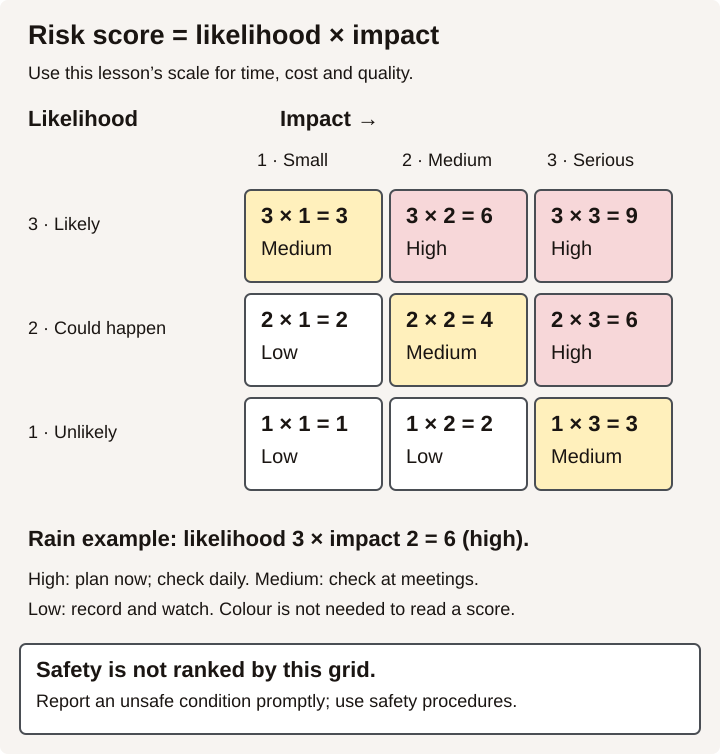

# Rate job risks in a risk register

## Why this matters on the job

Every job has things that might go wrong: rain on pour day, steel that arrives late, a wall that is not where the drawing says it is. A crew that has thought about these ahead of time has a backup ready. A crew that has not finds out at 7 a.m. with a truck waiting. Lead hands and superintendents keep a list of these risks, called a **risk register**, and check it at every planning meeting. This lesson uses the deck and handrail jobs from [lesson 11](../11-break-a-job-into-a-work-breakdown-structure/learner.html).

## Key ideas

### A risk has not happened yet

- A **risk** is something that **might** happen and would hurt the job: its time, cost, quality or someone's safety. "The lumber delivery could be late."
- An **issue** is something that **has** happened. "The lumber delivery did not come." Issues need action now, like the schedule recovery in [lesson 10](../10-recover-a-late-schedule/learner.html).

A good risk register turns risks into plans before they become issues.

### Write a risk as cause, event, effect

"Weather" is not a risk you can act on. Write three parts:

> **Because** the forecast shows rain on Tuesday (cause), **the footing pour may be put off** (event), **which pushes every later task back** (effect).

### Score the likelihood and the impact

Use a 1 to 3 scale. A job sets its own scale. This is the one used in this lesson:

| Score | Likelihood | Impact |
|---|---|---|
| 1 | Unlikely | Small: less than half a day, or under $200 |
| 2 | Could happen | Medium: half a day to 2 days, or $200 to $1,000 |
| 3 | Likely | Serious: more than 2 days, or over $1,000, or the work must be torn out |

Choose the highest applicable impact across time, cost and rework. For example, a delay of one day with a cost over $1,000 has impact 3, not 2.

**Risk score = likelihood × impact.** Scores run from 1 to 9.

- **6 or 9:** high. Plan a response now and watch it every day.
- **3 or 4:** medium. Plan a response and check it at each planning meeting.
- **1 or 2:** low. Write it down and keep an eye on it.

<figure class="figure-art">

<figcaption>Read across impact 1, 2, 3. Likelihood 3 gives 3 medium, 6 high, 9 high. Likelihood 2 gives 2 low, 4 medium, 6 high. Likelihood 1 gives 1 low, 2 low, 3 medium. These are the lesson’s practice categories, not a universal risk standard. <a href="risk-score-matrix.svg">Open the full-size diagram</a>.</figcaption>
</figure>

### Safety comes first

A risk register is for the job's time, cost and quality. It does **not** replace the safety hazard checks you learn in safety training. If anything on your list could hurt someone, do not wait for a meeting: in BC, anyone who sees what appears to be an unsafe or harmful condition must report it as soon as possible to a supervisor or the employer (WorkSafeBC OHS Regulation section 3.10).

### Four ways to respond

| Response | What you do | Example |
|---|---|---|
| **Avoid** | Change the plan so the risk cannot happen. | Measure on site before cutting steel, so the rail cannot be built to wrong numbers. |
| **Reduce** | Make it less likely or less serious. | Order lumber a week early. Book a backup pump. |
| **Share** | Give it to someone better placed to handle it, by agreement. | The supplier agrees in writing to a delivery date. |
| **Accept** | Live with it and keep an if-then backup ready. | If a crew member is off sick, then the lead hand moves a worker from the other site. |

### Give each risk an owner and a warning sign

- **Owner:** one named person who watches the risk and starts the response. "Everyone" means nobody.
- **Trigger:** the warning sign that the risk is starting to happen. "Supplier has not sent a shipping notice by Wednesday noon."

### Worked example: the backyard deck

Riverbend Decks (fictional) listed five risks for the deck. L is likelihood and I is impact.

| No. | Risk (cause, event, effect) | L | I | Score | Response | Owner | Trigger |
|---|---|---:|---:|---:|---|---|---|
| R1 | Rain is forecast this week, so the footing pour may be put off and the whole job slides. | 3 | 2 | **6** | Reduce: book the pour for the driest day and have tarps on site. | Marcus | Forecast over 60% chance of rain the evening before |
| R2 | The lumber yard is busy, so the delivery may be late and framing waits. | 2 | 2 | **4** | Reduce: order a week early and confirm by phone. | Lena (office) | No delivery confirmation by Thursday |
| R3 | A hole may not reach firm soil, so the footing inspection may fail and the holes are redug. | 1 | 3 | **3** | Reduce: check depth and soil before calling the inspector. | Marcus | Soft soil at the bottom of any hole |
| R4 | A crew member may be off sick, so framing slows. | 2 | 1 | **2** | Accept: if someone is off, then move a worker from the other site. | Marcus | A sick call before 6:30 a.m. |
| R5 | The supplier may send the wrong size joist hangers, so joists wait. | 2 | 1 | **2** | Reduce: check the hardware against the order when it arrives. | Apprentice | Packing slip does not match the order |

Ranked: R1 (6), R2 (4), R3 (3), R4 and R5 (2). R1 is the only high risk, so Marcus checks the forecast every evening this week.

Learners who want more practice with job numbers can open the Numeracy Hub [Construction Operations tab](../../../numeracy/hub/index.html#conops).

## Practice

**Task 1** (level 1) Risk or issue? Write R or I beside each.

- a. The crane could be booked by another job that day.
- b. The inspector failed the framing this morning.
- c. The concrete truck might get stuck in traffic on the bridge.
- d. Two sheets of plywood arrived cracked.
- e. The new apprentice may not have steel-toe boots by Monday.
- f. The client changed the paint colour yesterday.

**Task 2** (level 2) Rewrite each vague risk as cause, event, effect. You may make up a sensible cause.

- a. "Steel."
- b. "The inspector."
- c. "Parking."

**Task 3** (level 2) Northshore Pipe and Steel (fictional) listed these risks for the 10-section handrail job from lesson 11. Work out each score, rank the risks from highest to lowest, and label each high, medium or low.

| No. | Risk | L | I |
|---|---|---:|---:|
| H1 | The stair was built a little different from the drawings, so rails built only to drawing numbers may not fit and must be rebuilt. | 3 | 3 |
| H2 | The steel supplier is short of pipe, so the material may come late and fabrication waits. | 2 | 3 |
| H3 | Drywall in the stairwell may not be finished on install day, so the install crew is sent home. | 2 | 2 |
| H4 | The only certified welder may be off sick, so welding waits. | 1 | 2 |
| H5 | The primer may be the wrong colour, so the painter complains. | 1 | 1 |

**Task 4** (level 3) For the two highest risks in Task 3:

- a. Choose a response (avoid, reduce, share or accept) and say what the crew will do.
- b. Name an owner (a job title is fine).
- c. Write a trigger.
- d. Write one if-then backup.

**Task 5** (level 2) Here are parts of a small commercial job (fictional). For each one, describe what could go wrong and state your assumptions about the delay, cost or rework. Use those assumptions to rate its **impact**: 1 (small), 2 (medium) or 3 (serious). Explain your rating. There is no single impact rating without those details. You cannot assign an overall **risk score** until you also know the likelihood. If your example could hurt someone, follow the safety reporting rule above rather than using this grid to decide whether to act.

- a. Concrete slab pour
- b. Roof membrane
- c. Sprinkler pressure test
- d. Painting the office walls
- e. Planting the front garden

**Task 6** (level 2) Back at the deck. It rained on Tuesday, as R1 warned, and the pour moved to Thursday.

- a. Is R1 still a risk, or is it now an issue?
- b. Write a one-line status update for the register.
- c. Does any other risk change because of the two-day move? Explain.

## Check yourself

1. What is the difference between a risk and an issue?
2. A risk has likelihood 2 and impact 3. What is its score, and is it high, medium or low?
3. Name the four ways to respond to a risk.
4. Why does each risk need one named owner?
5. What should you do right away if a risk on your list could hurt someone?
