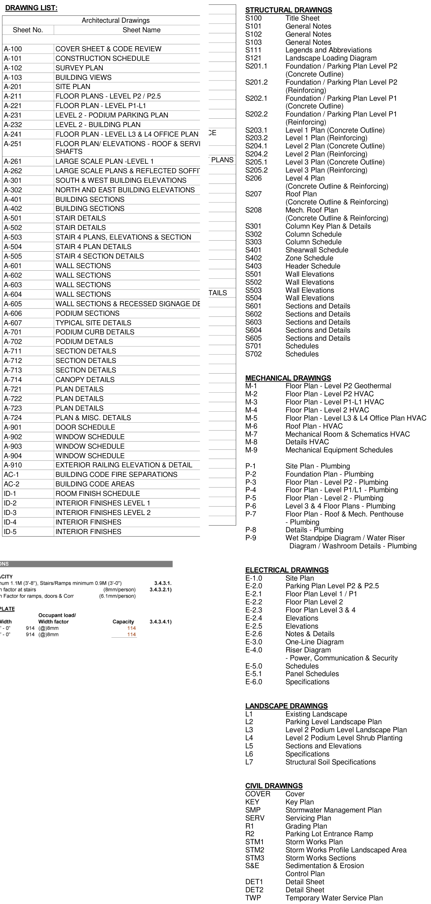
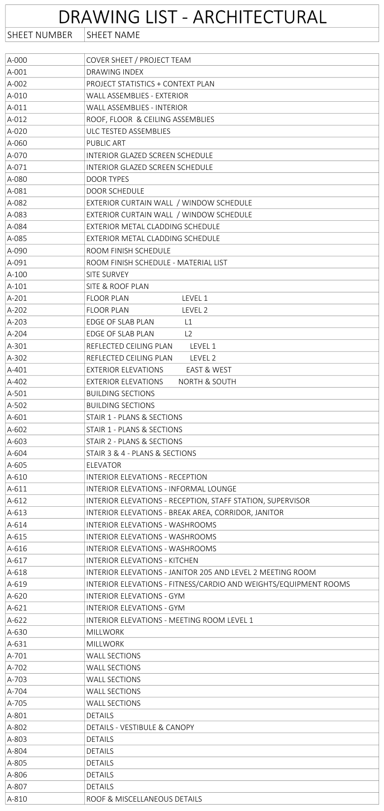
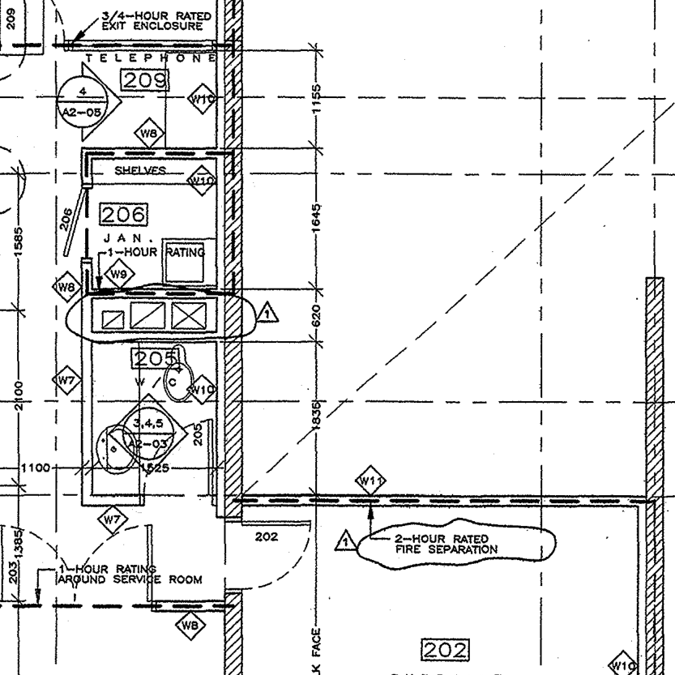
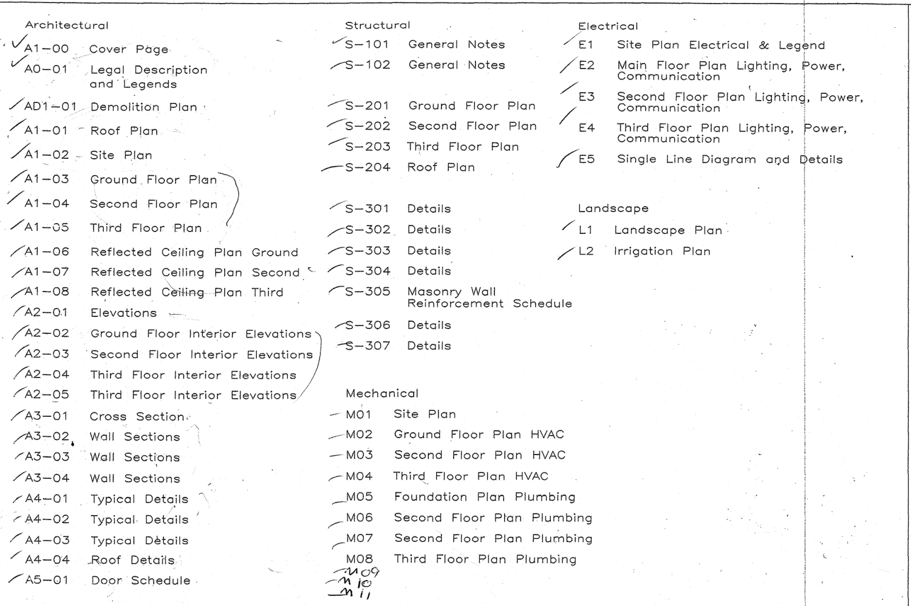
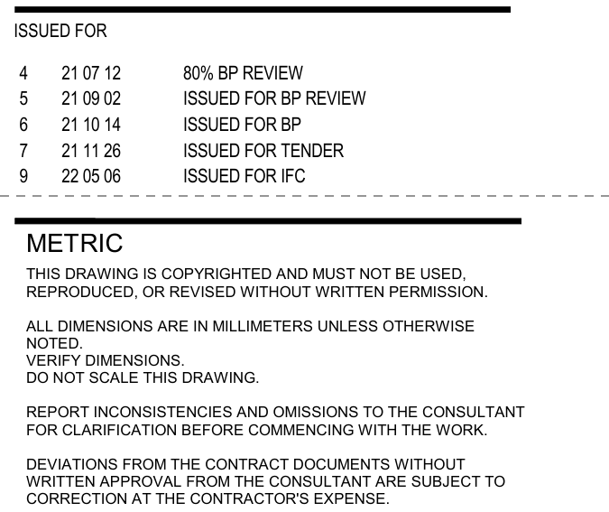
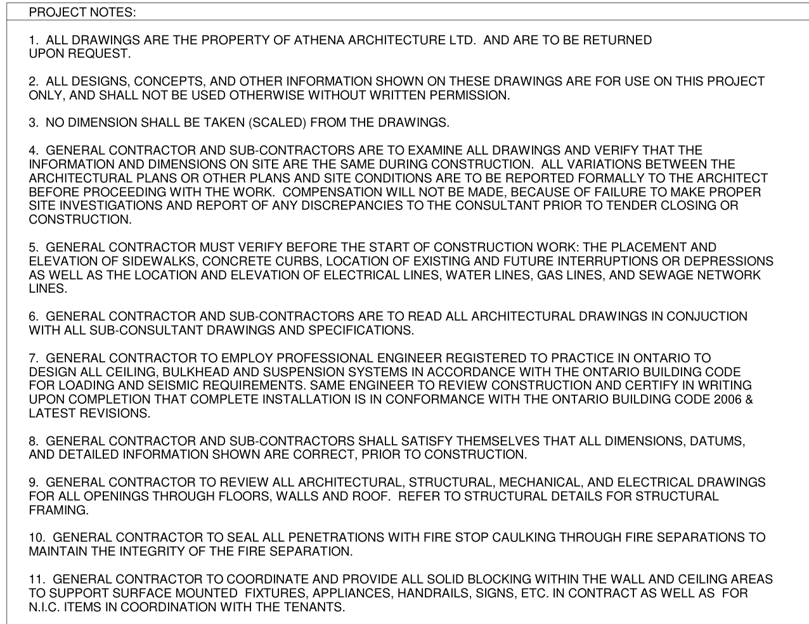
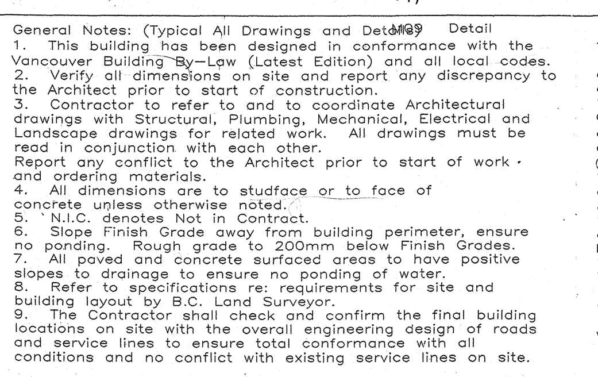
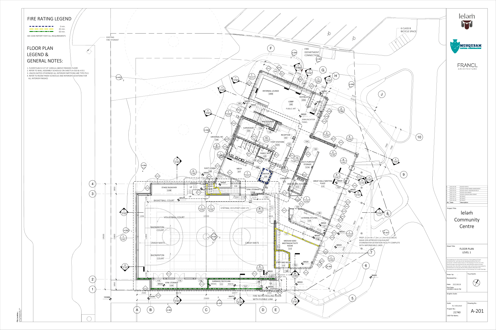

# Title blocks, sheet sets and the drawing index

## Why this matters on the job

A building is not drawn on one sheet. It is drawn on a set of 50, 100 or 200 sheets, split up by trade. Before you can read a dimension, you have to find the right sheet. Then you have to be sure it is the latest one. A crew that builds from an old issue of a sheet builds the wrong thing, and the work gets torn out. The title block, the drawing list and the revision marks are how you find the right sheet and prove it is current.

This lesson uses three real drawing sets. You will see that every office does things a little differently.

| Set | What it is | Stage and year | Units | Notes |
|---|---|---|---|---|
| **London Square** | Mixed-use building: 2 levels of parking, shops, 2 office floors | Issued for tender | Imperial (feet and inches) | A teaching set. Firm names on it, such as Athena Architecture Ltd., are made up (fictional). |
| **leləm̓ Community Centre** | Two-storey community centre with a gym, University Endowment Lands, BC | Issued for construction, 2022 | Metric (millimetres) | A full set from six consultants, drawn on a computer |
| **Fire Hall No. 3** | A Vancouver fire hall at 2801 Quebec Street | Construction set, 1999 | Metric | Paper prints that were scanned. A past reader added check marks and notes. |

## Key ideas

**1. A drawing set is a book of sheets, sorted by trade.** Each trade's sheets start with a **discipline letter**.

| Letter | Discipline | What you find there |
|---|---|---|
| A | Architectural | Floor plans, elevations, sections, doors, windows, finishes |
| S | Structural | Footings, columns, beams, slabs, rebar |
| M | Mechanical | Heating, ventilation and air conditioning (HVAC). Some offices put plumbing and fire protection here too. |
| P | Plumbing | Fixtures, drains, vents, water piping |
| E | Electrical | Lighting, power, panels, fire alarm, communications |
| L | Landscaping | Planting, trees, paving, irrigation |
| C | Civil | Site grading, storm and sanitary services, roads |
| F or FP | Fire protection | Sprinklers, standpipes, fire department connections |

The US National CAD Standard gives **F** to fire protection. Many offices still write **FP**. In all three sets in this lesson, fire protection sits inside the mechanical sheets. In leləm̓, plumbing does too (M2.00 to M2.03). London Square has its own **P** sheets.

**2. Sheet numbers.** A sheet number is the discipline letter plus a number, such as **A-201**. Many offices use the first digit for the kind of drawing: 1 for plans, 2 for elevations, 3 for sections, 5 for details, 6 for schedules. But every office has its own habit.

| Kind of sheet | London Square | leləm̓ | Fire Hall No. 3 |
|---|---|---|---|
| Floor plans | A-211 to A-251 | A-201, A-202 | A1-03 to A1-05 |
| Elevations | A-301, A-302 | A-401, A-402 | A2-01 |
| Building sections | A-401, A-402 | A-501, A-502 | A3-01 |
| Door schedule | A-901 | A-081 | A5-01 |

So A-401 is a section in London Square but an elevation in leləm̓. **Never guess a sheet from its number. Look it up in the drawing list.**

**3. The cover sheet and drawing list.** The first sheet of a set (or of each discipline) holds the **drawing list**, also called the **drawing index** or sheet list. It gives every sheet number and sheet name. It is the table of contents of the set.

**4. The title block.** Every sheet has a title block, usually down the right side or along the bottom. It tells you:
- the project name and the firm that drew the sheet
- the **sheet title** (what is on it) and the **sheet number**
- the **scale** ("As indicated" means each view has its own scale under its title)
- who drew and checked it, and the **project number**
- the **issue block** or **revision block**, and often a **plot date** (when the file was printed)

**5. Issues and revisions.** Each time a sheet goes out, the issue block gets a new line: a number or letter, a date and a reason. Common reasons are "issued for building permit" (BP), "issued for tender" (IFT, for pricing), an addendum during tender, and "issued for construction" (IFC). Only build from the issue meant for construction.

When an area of a drawing changes, the drafter draws a wavy **revision cloud** around it. A small triangle called a **delta** sits beside the cloud. The number in the delta matches a line in the revision block. That line tells you when and why it changed.

**6. Dates are written many ways.** The three sets write dates like this: 2022.05.06, 21 11 26, Feb 10 14, Nov 8/99 and 08/11/99. A date such as 08/11/99 could mean August 11 or November 8. Read the other dates on the sheet to decide. When you write a date yourself, the safe all-number form in Canada is **year-month-day**, for example 2022-05-06.

**7. General notes.** General notes apply to the whole sheet or the whole set unless a note on the drawing says otherwise. They often tell you the units, how dimensions are measured, and not to scale the drawing.

**8. How to find a sheet.**
1. Decide which trade the question belongs to.
2. Open the drawing list. Find the sheet name that matches.
3. Go to that sheet. Check the sheet number in the title block.
4. Check the issue block. Is this the latest issue, and is it for construction?
5. Read the general notes on that sheet before you take a number from it.

### Worked example

**Question:** In London Square, which sheet shows the Level 4 floor plan, and what is its latest issue?

1. A floor plan is architectural, so look in the Architectural Drawings list on the cover sheet A-100 (Figure 1).
2. The list shows **A-241 FLOOR PLAN - LEVEL L3 & L4 OFFICE PLAN**.
3. Go to A-241 (Figure 4). The title block says drawing number A-241 and sheet title "Floor plan - Level L3 & L4 office plan".
4. The revision block has three lines. The top line is the latest: **C, Feb 10 14, issued for tender**.
5. **Answer: A-241. Its latest issue is C, issued for tender.** That is a pricing issue, not a construction issue. Ask for the construction issue before you build from it.

## Practice documents

All figures are cut from the real sheets. Tap a figure to open it full size, then zoom in.

<figure class="figure-art" tabindex="0" aria-label="Figure 1, scroll sideways on a small screen" style="margin:16px 0"><figcaption><strong>Figure 1.</strong> London Square, sheet A-100 Cover sheet and code review, drawing list. Athena Architecture Ltd. (fictional firm name as printed).</figcaption></figure>

<figure class="figure-art" tabindex="0" aria-label="Figure 2, scroll sideways on a small screen" style="margin:16px 0"><figcaption><strong>Figure 2.</strong> leləm̓ Community Centre, sheet A-001 Drawing index, architectural drawing list. Francl Architecture.</figcaption></figure>

<figure class="figure-art" tabindex="0" aria-label="Figure 3, scroll sideways on a small screen" style="margin:16px 0"><figcaption><strong>Figure 3.</strong> leləm̓ Community Centre, sheet A-201 Floor plan Level 1, title block cut into two columns to fit the page. Francl Architecture.</figcaption></figure>

<figure class="figure-art" tabindex="0" aria-label="Figure 4, scroll sideways on a small screen" style="margin:16px 0"><figcaption><strong>Figure 4.</strong> London Square, sheet A-241 Floor plan Level L3 and L4 office plan, title block. The logos and client name in the middle are left out. Athena Architecture Ltd. (fictional).</figcaption></figure>

<figure class="figure-art" tabindex="0" aria-label="Figure 5, scroll sideways on a small screen" style="margin:16px 0"><figcaption><strong>Figure 5.</strong> Fire Hall No. 3, Vancouver, sheet A1-04 Second floor plan, title block from a 1999 scanned print. The Iredale Partnership with Matsuzaki Architects Inc.</figcaption></figure>

<figure class="figure-art" tabindex="0" aria-label="Figure 6, scroll sideways on a small screen" style="margin:16px 0"><figcaption><strong>Figure 6.</strong> Fire Hall No. 3, sheet A1-04 Second floor plan, two revision clouds with their deltas.</figcaption></figure>

<figure class="figure-art" tabindex="0" aria-label="Figure 7, scroll sideways on a small screen" style="margin:16px 0"><figcaption><strong>Figure 7.</strong> Fire Hall No. 3, Volume III cover sheet, drawing list. The check marks and the hand-written M09 to M11 were on the print when it was scanned.</figcaption></figure>

<figure class="figure-art" tabindex="0" aria-label="Figure 8, scroll sideways on a small screen" style="margin:16px 0"><figcaption><strong>Figure 8.</strong> leləm̓ Community Centre, sheet E-000 Electrical cover sheet and drawing list, issue list and general notes. DIALOG.</figcaption></figure>

<figure class="figure-art" tabindex="0" aria-label="Figure 9, scroll sideways on a small screen" style="margin:16px 0"><figcaption><strong>Figure 9.</strong> London Square, sheet A-100 Cover sheet and code review, project notes. Athena Architecture Ltd. (fictional).</figcaption></figure>

<figure class="figure-art" tabindex="0" aria-label="Figure 10, scroll sideways on a small screen" style="margin:16px 0"><figcaption><strong>Figure 10.</strong> Fire Hall No. 3, Volume III cover sheet, general notes 1 to 9.</figcaption></figure>

<figure class="figure-art" tabindex="0" aria-label="Figure 11, scroll sideways on a small screen" style="margin:16px 0"><figcaption><strong>Figure 11.</strong> leləm̓ Community Centre, sheet A-201 Floor plan Level 1, the whole sheet. Francl Architecture.</figcaption></figure>

## Practice

**Task 1** (level 1)
Use Figure 1 (London Square drawing list).
a) What is the sheet number of the door schedule?
b) Which letter starts the plumbing sheets, and how many plumbing sheets are there?
c) A drywaller wants the room finish schedule. Which sheet is it on?
d) An electrician wants the electrical floor plan for Levels 3 and 4. Which sheet?

**Task 2** (level 1)
Use Figure 3 (leləm̓ A-201 title block).
a) What is the sheet number and the sheet title?
b) What is the project number?
c) What is the latest issue: its number, date and description?
d) What does the last sentence of the long note say about scaling? Is it spelled correctly?

**Task 3** (level 1)
Use Figure 5 (Fire Hall A1-04 title block).
a) What is the sheet number and the drawing title?
b) What is the current revision number?
c) What is written in the "Drawn" box?
d) What kind of scale does this title block give: a ratio such as 1:100, or a bar?

**Task 4** (level 2)
Write each date in the form year-month-day (YYYY-MM-DD).
a) leləm̓ A-201, issue 8: 2022.05.06
b) leləm̓ E-000, issue 7: 21 11 26
c) Fire Hall title block: 08 November 99
d) Fire Hall title block: "Printed on 08/11/99". Is that August 11 or November 8? Which other date on the same title block tells you?

**Task 5** (level 2)
Use Figure 6 (Fire Hall revision clouds) and Figure 5.
a) How many revision clouds are in Figure 6?
b) What number is in each delta triangle?
c) Where on the sheet do you read what revision 1 was? What does it say?
d) What is inside each cloud?

**Task 6** (level 2)
Compare the issue lists in Figure 3 (leləm̓ A-201) and Figure 8 (leləm̓ E-000).
a) Both sheets were issued for construction on the same day. What date?
b) The E-000 list jumps from issue 7 to issue 9. What is missing?
c) An electrician has an E-000 print marked issue 7. Can they build from it? Why or why not?

**Task 7** (level 2)
Use Figure 7 (Fire Hall drawing list).
a) Which sheets show wall sections?
b) Which sheet is the door schedule?
c) How many structural sheets are printed in the list?
d) Which sheets were added by hand?

**Task 8** (level 2)
Use Figures 8, 9 and 10 (general notes).
a) In leləm̓ E-000, what unit are dimensions in, unless noted otherwise?
b) What does London Square project note 3 say?
c) A framer is checking a room size on the Fire Hall drawings. Note 4 says dimensions are measured to what?
d) What does N.I.C. mean on the Fire Hall drawings?

**Task 9** (level 3)
You are a plumber pricing the Fire Hall job. You need the ground floor plumbing plan. Use Figure 7.
a) Look at sheets M05 to M08. What problem do you see in the sheet names?
b) Which floor seems to be missing from the plumbing names, and why can you not be sure from the list?
c) What would you do before you order pipe and fittings?

_______________________________________________

_______________________________________________

**Task 10** (level 3)
The leləm̓ A-001 sheet (the sheet with the list in Figure 2) has 7 lines in its issue block: 1 to 4 are drafts and the building permit issue, 5 is 2021.12.10 Issued for Tender, 6 is 2022.02.15 Issued for BP Minor Amendment and 7 is 2022.05.06 Issued for IFC. Compare it with the A-201 issue block in Figure 3.
a) Which issue does A-201 have that A-001 does not? Give its date and description.
b) What does that tell you about each sheet's issue block?
c) Why must you check the issue block on every sheet you use, not only on the cover sheet?

**Task 11** (level 3)
Use Figures 3 and 11 (leləm̓ A-201).
a) What does the title block say for Scale and for Graphic Scale?
b) Look at the whole sheet in Figure 11. Is a scale written under the plan?
c) A labourer wants to measure the gym with a ruler on a half-size print. What would you tell them? Use the notes on the sheet in your answer.

_______________________________________________

_______________________________________________

## Check yourself

1. What does the discipline letter at the start of a sheet number tell you?
2. Why should you look up a sheet in the drawing list instead of guessing from its number?
3. Name five things you can find in a title block.
4. What do a revision cloud and a delta tell you, and where do you read the reason for the change?
5. How do you write the date November 8, 1999 in all numbers?

## Extra: what a CAD drawing is

Most drawing sets today are made on a computer with CAD (computer-aided design) software. AutoCAD is one common program. You do not need to use CAD to read the prints, but four CAD ideas explain things you will see on the sheets.

**1. Drawn full size, printed to scale.** In AutoCAD, the drafter draws in **model space** at full size (1:1), after deciding what one unit stands for, such as one millimetre. To print, they set up a **layout** in **paper space** with the title block and notes. On the layout, **viewports** show views of the full-size model, each at its own scale. That is how one sheet can show a plan at 1:100 and a detail at 1:20. Both views come from the same full-size drawing.

**2. Layers.** Every object is put on a **layer**, such as walls, doors or electrical wiring. Autodesk compares layers to clear plastic sheets. A layer can be turned off or frozen to hide everything on it. So two sheets made from the same file can show different things. If something you expect is missing from a print, it may be on a layer that was turned off. Ask before you assume it is not there.

**3. Blocks.** A **block** is a group of objects joined into one named object, such as a door symbol, a receptacle symbol or a title block. The drafter inserts the same block again and again. That is why every receptacle symbol on a set looks exactly the same.

**4. External references (xrefs).** An **xref** links one drawing file into another. For example, the architect's floor plan can be linked into the electrical drawing so the electrical engineer draws on top of the walls. Changes made to the linked file show up in the drawing when it is opened or the xref is reloaded. So a sheet can change because a file it links to changed. This is one more reason to build only from an issued sheet and to check its issue block.

**Task 12** (level 2)
a) A sheet shows a floor plan at 1:100 and a stair detail at 1:20. Did the drafter draw the stair twice, at two sizes? Explain with model space and layouts.
b) An electrician's print shows the walls of a floor, but no doors. Which CAD idea could explain this? What should the electrician do?
c) Every receptacle symbol on the electrical sheets looks exactly the same. Which CAD idea explains this?
d) The architect moved a wall on Monday. On Tuesday, someone in the office prints an electrical sheet, and the wall is in its new place. The issue block on the print has not changed. Which CAD idea explains why the wall moved? Why must the electrician still build from the issued sheet?

_______________________________________________

_______________________________________________
